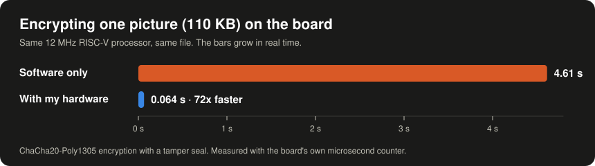
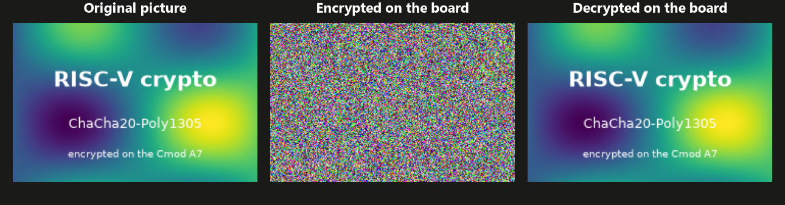
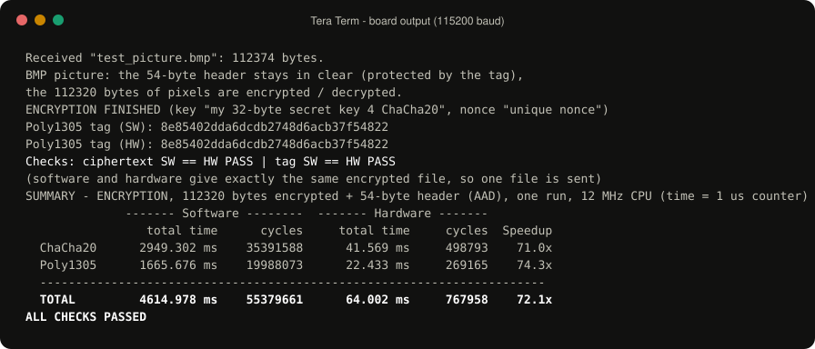
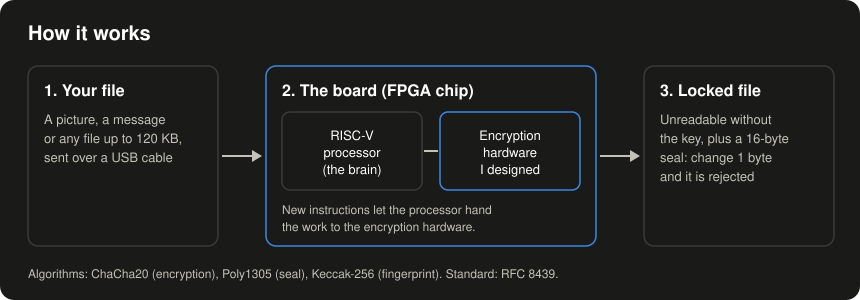

# RISC-V Hardware Encryption on FPGA

A small RISC-V processor on an FPGA chip, with encryption hardware I added to it.
It encrypts a 110 KB picture in **0.064 seconds instead of 4.6 seconds**, 72 times faster
than the same processor can do it in software.

<p align="center">
  
</p>

## What it does

Small devices such as sensors and smart locks need to protect their data, but their
processors are slow at encryption. This project gives such a processor new instructions
that hand the work to circuits built only for encryption.

- ChaCha20 encrypts files and messages, so they are unreadable without the key.
- Poly1305 adds a 16-byte seal. If even one byte is changed, the board refuses to decrypt.
- Keccak-256 makes a fingerprint (hash) of the data.

Everything runs on a Digilent Cmod A7-35T FPGA board at 12 MHz. Every hardware result is
checked against the software version and against official test values.

<p align="center">
  
</p>

For a BMP picture the board encrypts only the pixels. The header stays readable, so the
encrypted file still opens and shows noise, and the seal still protects the header.

## Results

Measured on the board: the same processor runs each task in software, then with the
encryption hardware (1000 runs each; the picture: one run).

| Task | Faster with the hardware |
|---|---|
| Encrypt and seal a 110 KB picture (4.61 s → 0.064 s) | 72x |
| ChaCha20, one 64-byte block | 70x |
| Poly1305 seal of 64 bytes | 36x |
| ChaCha20-Poly1305, the internet standard [RFC 8439](https://www.rfc-editor.org/rfc/rfc8439) (64-byte message) | 26x |
| Keccak-256 hash of 64 bytes | 499x |

The encryption hardware uses 11,610 logic cells (LUTs) and 64 multipliers (DSPs). The whole
design fills about two thirds of the FPGA. Raw board outputs: [`results/`](results).

<p align="center">
  
</p>

## How it works

<p align="center">
  
</p>

- The processor is [NEORV32](https://github.com/stnolting/neorv32) (RV32IMC) with 5 custom
  instructions in the RISC-V CUSTOM-0 opcode. They write data to the accelerator, start it,
  and read the result.
- All encryption circuits are in one VHDL file, [`hw/crypto_accel.vhd`](hw/crypto_accel.vhd).
- C programs in [`neorv32-main/sw/example/demo_blink_led`](neorv32-main/sw/example/demo_blink_led)
  time each algorithm in software and in hardware with the CPU cycle counter and a 1 µs counter.
- The checks: a testbench with 30 tests (RFC 8439 and Keccak-256 test values), the same values
  on the board, and an independent Python reference in [`scripts/`](scripts).

## Can I run it?

| You have | What you can do |
|---|---|
| No board | Run the hardware in simulation with the free AMD Vivado (`hw\run_sim.bat`, 30 tests). The C versions of the algorithms run on any computer, without the speedup. |
| A Cmod A7-35T | Load the ready bitstream `demo/neorv32_crypto.bit` and follow [`demo/HOW_TO_RUN.md`](demo/HOW_TO_RUN.md). |
| Another FPGA board | Change the pin file (`Projects/Simple-Code/Simple-Code.srcs/constrs_1/new/Basys3_Master.xdc`, it holds the Cmod A7 pins) and rebuild in Vivado. AMD/Xilinx 7-series boards need the fewest changes. |

To try it on Windows (from the project folder):

```bat
:: no board: run the 30 hardware tests in the Vivado simulator
hw\run_sim.bat

:: build a program for the board, then send neorv32_exe.bin with Tera Term
cd neorv32-main\sw\example\demo_blink_led
make APP=my_crypto clean exe
```

It does not run as a phone or PC app: the speedup comes from the extra circuits on the chip.

Tools: AMD Vivado 2025.2, RISC-V GCC 15.2 (xPack), `make`, Tera Term 5. The scripts expect the
project in `D:\Graduation-Project`; if yours is elsewhere, change `VIVADO_BIN` in `hw\*.bat`.

## Status

Finished as my final-year computer engineering project (October 2026); it may still change.
It is a learning and research design: it has not been security-audited and does not defend
against side-channel attacks, so do not use it to protect real secrets.

## Credits and license

- Built by [Rayan Shareefi](https://github.com/Rayan-Shareefi). My code is under the [MIT license](LICENSE).
- [NEORV32](https://github.com/stnolting/neorv32) by Stephan Nolting (BSD 3-Clause), in `neorv32-main/`.
- The Poly1305 core comes from [FPGA-House-AG/ChaCha20Poly1305](https://github.com/FPGA-House-AG/ChaCha20Poly1305)
  (BSD 3-Clause) and the Keccak round logic from the Keccak team (public domain); see the file headers.
- The first software versions of the algorithms came from my project team.
